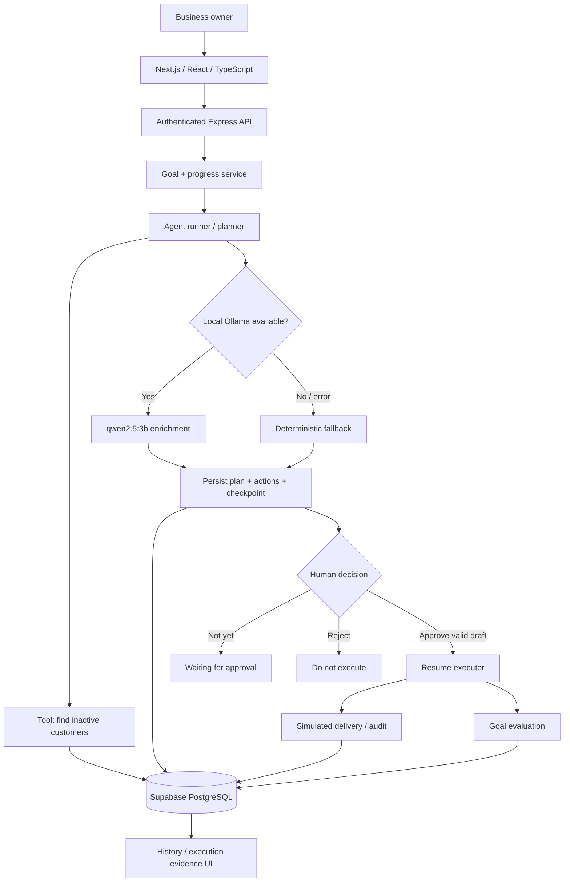

<div align="center">

# 🌱 GrowPilot AI

### A goal-driven, human-supervised AI Worker for small-business customer retention

**Analyze customers · Plan interventions · Request approval · Resume execution · Measure results**

[](https://nextjs.org/)
[](https://react.dev/)
[](https://www.typescriptlang.org/)
[](https://nodejs.org/)
[](https://supabase.com/)
[](https://ollama.com/)

**Working prototype · Synthetic data · Simulation-only outreach**

[Overview](#overview) · [Demo](#demonstration) · [Architecture](#architecture) · [Setup](#local-setup) · [Evaluation](#evaluation-evidence) · [Limitations](#limitations)

</div>

---

## Overview

A micro-entrepreneur with falling repeat business needs more than a chatbot: they need a dependable system that finds customers at risk of churning, recommends useful interventions, safely carries out approved work, and checks whether the business goal is being met.

**GrowPilot AI** is a full-stack prototype for that workflow. Its example entrepreneur is **Arun**, owner of **Arun Digital Services**. The application uses synthetic customers and transactions; it does **not** send actual SMS, WhatsApp, or email messages.

Unlike an isolated text-generation demo, GrowPilot AI stores its goals, runs, plans, actions, approval state, execution records and evaluation evidence in Supabase so work can continue after a backend restart.

### Defined business goal

| Field | Demo configuration |
|---|---|
| Business | Arun Digital Services (synthetic) |
| Goal | Improve repeat customer retention |
| Metric | `repeat_customer_rate` |
| Configured baseline | **20%** — illustrative, not historically verified |
| Target | **30%** |
| Target date | **22 December 2026** |
| Measurement | Repeat-customer rate derived from completed transactions within the evaluation window |

A recent demonstration evaluation reported **72% observed repeat-customer rate** and **100% goal progress** against the configured 30% target. **This is not proof that the AI Worker caused an increase**: the baseline was manually configured for the demo, and customer messages are simulated. The definition of done for the *engineering demonstration* is reliable planning, controlled execution, traceability and measurable evaluation—not a demonstrated real-world income increase.

## What the worker does

1. **Receives the goal** and loads saved business context and current goal progress.
2. **Uses tools** to identify inactive customers and rank retention opportunities.
3. **Plans actions**, optionally enriching strategies with local Ollama inference. If the model fails, it switches to deterministic recommendations.
4. **Persists the plan and checkpoint**, including actions requiring human review.
5. **Hands off to a human** to generate/review drafts and approve or reject actions.
6. **Resumes from persisted state**, executing only eligible approved actions in simulation; terminal actions are skipped on retry.
7. **Measures the business metric** from transaction records, stores an evaluation and suggests the next step.
8. **Exposes activity history and evidence** so a reviewer can inspect decisions and failures.

### Interfaces

| Route | What it shows |
|---|---|
| `/` | Dashboard and business summary |
| `/customers` | Searchable customer directory and activity |
| `/agent` | Goal-driven agent runs and proposed interventions |
| `/approvals` | Draft review, approvals, Resume Worker, Evaluate Goal |
| `/analytics` | Transactions, service-fee revenue, trends |
| `/insights` | Business insights |
| `/history` | Agent events, approvals, simulated execution, evidence panel |
| `/settings` | Application and business settings |

The UI is authenticated, with business membership and role checks in backend routes. Owner/admin permissions protect sensitive execution operations. Do not treat this prototype as a production security certification.

## Architecture



### Main components

| Layer | Technology / purpose |
|---|---|
| Frontend | Next.js 16, React 19, TypeScript, Tailwind CSS, TanStack React Query, Axios, Recharts |
| API | Node.js, Express, Zod request validation |
| Persistence | Supabase Postgres: business data, agent goals/runs, checkpoints, actions, execution logs and evaluations |
| Inference | Local Ollama with `qwen2.5:3b`; deterministic fallback when unavailable |
| Execution | Saved-state resume with human approval; outbound communication simulated |
| Observability | Run/step/action logs, history view, evaluation results |

**Why this design?** Business decisions and authorization remain in normal application code; the LLM is an optional strategy-enrichment component, not a source of unrestricted authority. Supabase persists state across backend restarts. Specialized responsibilities are separated into planning, tools, execution, and evaluation services; this prototype does not claim to run a distributed multi-agent framework.

## Demonstration

Use synthetic data only. The UI workflow is:

1. Log in and open **AI Agent** (`/agent`). Run a retention worker.
2. Inspect prioritized customers, model source and saved recommendations.
3. Open **Approvals** (`/approvals`). Generate a draft and approve one suitable action.
4. Click **Resume Worker** to execute the approved action **in simulation**.
5. Click **Evaluate Goal** to read actual transaction-based goal progress.
6. Open **History** (`/history`) to inspect logs and evidence.

To demonstrate a **restart**, approve a valid action but do not resume; stop the backend (`Ctrl+C`), restart it, and then resume the saved run. To demonstrate **retry safety**, call the authenticated `POST /api/agent/:runId/resume` again for that same run and verify that the completed action is skipped and only one `message_deliveries` row remains.

To demonstrate **model failure**, stop the Ollama listener, confirm `http://localhost:11434/api/tags` is unavailable, then start a *new* agent run. Confirm `ai.strategySource = deterministic_fallback`, inspect `ai.fallbackReason`, and confirm the plan is persisted awaiting human approval. Restart Ollama afterward.

> **Permissions and consent:** All execution in the demo is simulated. Some sample customers have `marketingConsent: false`; no live marketing outreach should occur without appropriate consent and additional production safeguards.

## Evaluation evidence

The tested scenarios are documented in **[`docs/EVALUATION.md`](docs/EVALUATION.md)**.

| Scenario | Observed result | Scope |
|---|---|---|
| Approved action, resume after backend restart | **PASS** — one simulated action executed | Persisted-state recovery demonstrated |
| Retry the completed action | **PASS** — `executed: []`, completed action skipped | Post-retry `message_deliveries` count remained **1** |
| Approved action missing a valid saved draft | **PASS (safe block)** — action not executed, manual review requested | Action needs separate remediation |
| Ollama unavailable | **PASS** — deterministic fallback; **4** actions saved and **9** logs recorded | Local model connection refused; model-enriched actions **0** |
| Goal measurement | **Working** — observed repeat rate **72%**, target **30%** | No valid causal attribution; baseline illustrative |

**Reproducible identifiers for the captured synthetic test:**

- Run (fallback and retry example): `f4cb5b3f-26dd-45dc-8b61-8a14893034d8`
- Completed action: `9e6023c3-a526-450c-9a5f-47ce06b8409d`
- Missing-draft adverse run: `6314e924-841c-4d2a-8c56-dbafe7822edd`

These identifiers refer to the author's development database; another installation will generate different IDs. A fresh clone needs compatible database schema, authentication configuration and synthetic seed data to reproduce the entire experience.

### Inference and cost notes

- **Primary:** local `qwen2.5:3b` using Ollama.
- **Fallback:** deterministic retention strategy when model inference fails.
- **Measured fallback example:** `ECONNREFUSED 127.0.0.1:11434`, 4,907 ms total worker-run duration (not LLM latency).
- **Cost:** hosted-model API charges are avoided for this local demonstration, but machine electricity, memory and operational costs are not zero; precise per-run cost/token totals have **not** been measured.

## Local setup

### Prerequisites

- Windows/macOS/Linux, Node.js and npm compatible with the frontend/backend package dependencies.
- An accessible Supabase project with the **required application schema, RLS/auth setup and synthetic seed data**.
- Ollama and local model `qwen2.5:3b`.
- A Supabase demo user authorized for the synthetic business.

> **Reproducibility limitation:** Database migrations/seed instructions and verified `.env.example` files must be provided/checked before claiming a one-command fresh setup. The variable names below are intentionally *not guessed*. Inspect `backend/src/` and `frontend/src/` configuration and include safe example files based on actual code before submission.

### 1. Clone

```bash
git clone https://github.com/im-arunkr/growpilot-ai.git
cd growpilot-ai
```

### 2. Environment configuration

Create local configuration files based on the actual imports/config modules:

```text
backend/.env
frontend/.env.local
```

Check project code and, where available, copy `backend/.env.example` and `frontend/.env.example`. Configure backend port, Supabase URL and server-only credentials, Ollama endpoint, and the frontend's public API URL and auth configuration as needed by the actual application. **Do not copy service-role keys, bearer tokens or private credentials into the README or frontend bundle.** Ensure the demo business is accessible to the logged-in user.

### 3. Install and start Ollama

```bash
ollama pull qwen2.5:3b
ollama serve
```

If Ollama is already running as a desktop app or service, you do not need a second `ollama serve`. Confirm readiness with `ollama list` or `curl http://localhost:11434/api/tags`.

### 4. Backend

```bash
cd backend
npm install
npm run dev
```

Default local development API: `http://localhost:5000` (subject to environment settings).

### 5. Frontend — separate terminal

```bash
cd frontend
npm install
npm run dev
```

Open **http://localhost:3000** and sign in with a configured synthetic-demo account.

### 6. Build checks

```bash
cd frontend
npm run build
```

Use `npm run` in each folder to inspect other scripts and any backend test/build scripts. Successful installation and build have **not** been independently verified from a fresh clone for this README update.

## Selected API endpoints

Most API operations require an authenticated user and authorized business membership. Consult `backend/src/routes/` for exact payloads and middleware.

| Method | Endpoint | Purpose |
|---|---|---|
| `POST` | `/api/agent/run` | Generate and persist a new retention agent run |
| `POST` | `/api/agent/:runId/resume` | Resume saved approved actions in simulation |
| `POST` | `/api/agent/:runId/goal-evaluation` | Evaluate measurable goal for a saved run |
| `GET` | `/api/agent/history?businessId=...` | Paginated agent/execution events |
| `GET` | `/api/approvals/approved` | Approved actions |
| `GET` | `/api/approvals/history` | Simulated execution history |
| `GET` | `/api/analytics?businessId=...` | Business metrics and transaction trends |

> Some request contracts depend on the user's authentication and current business context. Use the actual client requests/network inspector as the source of truth; IDs and credentials in this README are not a reusable login.

## Persistence and safety model

- **Checkpointing:** agent runs, steps and actions are persisted, permitting a later resume call after backend restart.
- **Human handoff:** execution waits for approval. Actions with missing/invalid saved drafts are blocked and returned for manual review.
- **Retry handling:** completed actions are skipped; in the observed retry test, a single simulated delivery remained stored.
- **Business boundaries:** authenticated API routes and business membership checks restrict access; approved execution requires appropriate role.
- **Fallback:** deterministic planning is used when local model enrichment fails; it cannot bypass approval.
- **Auditability:** logs and event history preserve what the system did, including fallback decisions.
- **Limits:** one observed idempotent retry does not establish exactly-once guarantees under concurrent workers or crash-mid-write scenarios.

## Repository structure

```text
growpilot-ai/
├── frontend/
│   └── src/
│       ├── app/
│       │   └── (dashboard)/
│       │       ├── page.tsx
│       │       ├── customers/
│       │       ├── agent/
│       │       ├── approvals/
│       │       ├── analytics/
│       │       ├── insights/
│       │       ├── history/
│       │       └── settings/
│       ├── features/
│       └── lib/
├── backend/
│   └── src/
│       ├── agent/
│       ├── routes/
│       ├── controllers/
│       └── services/
├── docs/
│   └── EVALUATION.md
└── README.md
```

This diagram lists significant folders, not every source file.

## Limitations

1. **Synthetic business data** only; simulated messages have no real customer-delivery or response signal.
2. **Causality not established:** 72% is an observed synthetic-data metric, not an AI-driven improvement over a validated 20% historical baseline.
3. **No live messaging** or consent-verified production outreach.
4. **No proven concurrency safety** or fully transactional, exactly-once guarantees for all failure modes.
5. **No fully autonomous continuous monitoring loop** demonstrated; user actions initiate parts of the workflow.
6. **Incomplete fresh-clone reproducibility** until database schema, seed/migrations, verified environment examples and login setup are packaged and exercised.
7. **Incomplete cost telemetry** for precise model token usage, compute and provider comparisons.

## Roadmap and project status

**Implemented in the current prototype:** dashboard, customers, agent, approvals, analytics, insights, history, settings, authenticated business-scoped workflow, checkpointed worker resume, deterministic fallback, goal evaluation and simulation audit records.

**Before production:** complete reproducible database setup, automated integration/concurrency tests, consent and communication controls, proper outreach provider integrations, metrics baselines and attribution, operational monitoring, deployment hardening and ongoing replanning policy.

## Documentation and submission

- [Evaluation report](docs/EVALUATION.md) — successful execution, failure cases, limitations, retry evidence.
- Architecture diagram — included above; can be exported as an image for the submission.
- Demo walkthrough — follow [Demonstration](#demonstration) and capture UI plus run-level traces.
- Learning note, demo video URL, and verified `.env.example` + synthetic seed setup — **to be added before final submission**; do not mark them complete prematurely.

## Responsible use

GrowPilot AI is a **development demonstration**, not a ready-to-deploy customer marketing system or a validated business-growth claim. AI output should be reviewed, sensitive credentials kept server-side, personal data protected, and actual customer outreach enabled only after consent, authorization and operational safeguards are implemented.

---

<div align="center">

**🌱 Grow smarter. Retain better. Stay in control.**

*GrowPilot AI — goal-driven automation with human accountability.*

</div>
