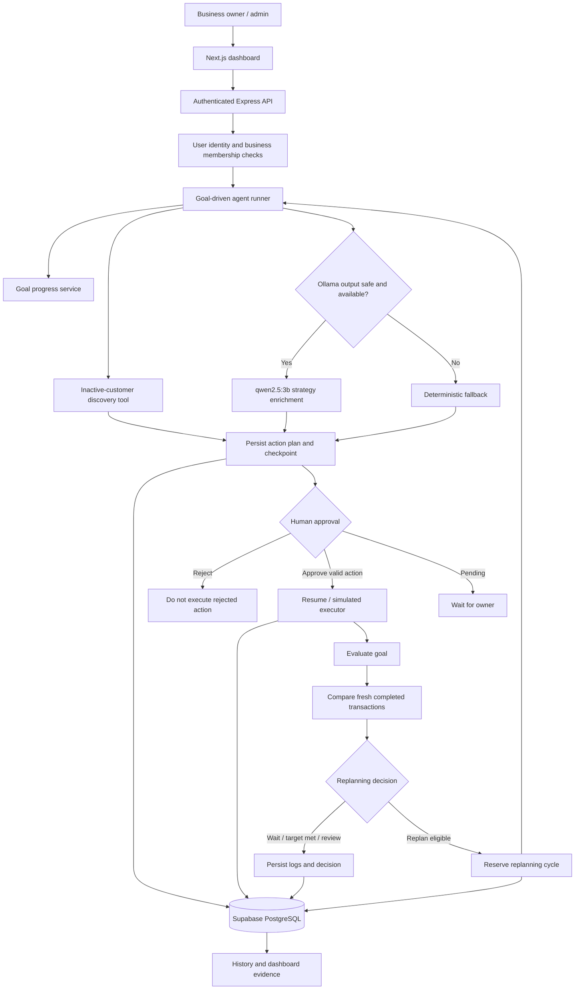

<div align="center">

# 🌱 GrowPilot AI

### A goal-driven, human-supervised autonomous AI Worker for small-business customer retention

**Analyze customers · Plan interventions · Request approval · Resume safely · Evaluate outcomes · Replan from new evidence**

[](https://nextjs.org/)
[](https://react.dev/)
[](https://www.typescriptlang.org/)
[](https://nodejs.org/)
[](https://supabase.com/)
[](https://ollama.com/)

**Working local prototype · Synthetic data · Simulation-only outreach · Human approval required**

[Overview](#overview) · [Workflow](#worker-workflow) · [Architecture](#architecture) · [Demo](#demonstration) · [Evaluation](#verified-evaluation-evidence) · [Setup](#local-setup) · [Limitations](#known-limitations)

</div>

---

## Overview

A micro-entrepreneur losing repeat customers needs more than a chatbot. They need a dependable system that measures a business goal, identifies retention opportunities, proposes interventions, waits for human approval, executes permitted actions, checks updated business activity, and decides whether another plan is warranted.

**GrowPilot AI** demonstrates that loop with an authenticated Next.js dashboard, an Express orchestration backend, Supabase persistence, and optional locally hosted Ollama inference. The example digital-services business and every customer/transaction in this demonstration are **synthetic**. It does **not** send real WhatsApp, SMS, or email messages.

The worker is *goal-oriented* rather than a one-shot content generator: it measures a defined retention metric, persists plans and action state, resumes after human decisions, evaluates observed transactions, and can create a **new successor run when fresh evidence is detected and the goal remains unmet**. The feedback loop is **API-triggered**; it is not an unattended scheduler or continuous background service.

### Business goal and measurement

`repeat_customer_rate` is calculated from **completed transactions in a rolling 30-day window**: the percentage of active customers who have at least two completed transactions in that window. A configured baseline is descriptive demo input, not a verified historical control group.

Two different synthetic scenarios are retained intentionally:

| Scenario | Configured baseline | Target | Observed result | Interpretation |
|---|---:|---:|---:|---|
| Original demo business (Arun Digital Services) | 20% | 30% | 72% observed in a prior test | Target surpassed in synthetic data; no causal attribution |
| Isolated replanning test (GrowPilot Replanning Test Shop) | 20% | 80% | 50% before and after the evidence insertion | Target not reached; enables a real feedback/replanning decision |

The isolated test had **12 customers and 13 initial transactions**. Its 50% result reflects **1 repeat customer among 2 active customers** in the measurement window. One later completed transaction for an already-active repeat customer supplied new evidence **without raising the repeat rate to 80%**. **The new transaction is synthetic test input, not proof that an outreach message caused a purchase.**

## Worker workflow

1. **Understand the goal:** Load the authorized business, active goal, baseline, target, deadline, and observed performance.
2. **Discover opportunities:** Call the `find_inactive_customers` tool; prioritize at-risk customers and filter customers with open actions.
3. **Plan:** Generate a deterministic retention action plan; optionally enrich content with local `qwen2.5:3b` via Ollama. Unsafe/unavailable model output falls back to deterministic planning.
4. **Persist:** Store agent run, plan, action records, logs, and resume state in Supabase.
5. **Human handoff:** Owner/admin reviews or rejects proposed actions; drafts and authorization are validated server-side. No approval means no execution.
6. **Execute safely:** Approved, eligible actions run only through **simulated delivery**. Completed/rejected actions are skipped on resume, including after a backend restart.
7. **Evaluate:** Calculate the current repeat-customer rate from transactions and persist a goal evaluation with an audit event.
8. **Inspect fresh evidence:** Before overwriting the previous evaluation, compare newly completed transactions against its timestamp.
9. **Decide:** Wait when approvals/actions are outstanding or evidence is missing; stop when target is reached; otherwise consider a new plan subject to guardrails and replanning limits.
10. **Replan:** Reserve a persisted replanning cycle and create a **new run with a new plan** for owner review. The successor does not automatically execute outreach.

### Decision examples

| Decision | Meaning |
|---|---|
| `wait_for_existing_actions` | Outstanding approvals or executable actions must be resolved first |
| `wait_for_new_evidence` | No new qualifying completed transaction since the previous evaluation |
| `replan_required` | Goal remains below target and new business evidence supports another planning cycle |
| `goal_target_reached` | Measured metric is at or above target |
| `manual_review` | A configured limit or invalid/uncertain state needs human intervention |

**Replanning is bounded:** a maximum of **three** cycles is configured in the decision/orchestration logic. Each cycle stores a parent run, optional successor run, decision/evidence metadata, and status in `agent_replanning_cycles`. The demonstrated duplicate protection covers **sequential repeat resume**; concurrency and crash-mid-write guarantees are **not** established.

## Architecture



The **LLM proposes or enriches content; it does not authorize actions**. Planning, permissions, state transitions, persistence, goal measurement, and replanning limits remain in application code. Responsibilities are separated into services rather than claimed as a distributed multi-agent system.

### Main stack

| Layer | Implementation |
|---|---|
| Frontend | Next.js 16, React 19, TypeScript, Tailwind CSS, TanStack Query, Axios, Recharts |
| Backend | Node.js, Express, Zod validation |
| Authentication / authorization | Supabase Auth tokens; business-membership and role checks on backend routes |
| Persistence | Supabase PostgreSQL; business data, goals, runs, action plans, action state, logs, evaluations, replanning cycles |
| Inference | Local Ollama `qwen2.5:3b`; deterministic fallback |
| Execution | Explicit owner/admin approval; simulated-only message delivery |
| Observation | Run/action logs, persisted goal evaluations and evidence-based successor cycles |

### Important implementation files

```text
backend/src/services/
  agentResume.service.js
  goalEvaluation.service.js
  goalProgress.service.js
  replanningDecision.service.js
  replanningEvidence.service.js
  replanningOrchestrator.service.js
backend/database/
  schema.sql
  seed.sql
  auth_setup.sql
  replanning_cycles.sql
  replanning_test_seed.sql
frontend/src/components/agent/
  replanning-panel.tsx
  worker-replanning-status.tsx
```

Some names above represent files added during the current feature work. Confirm all are committed before relying on a fresh-clone setup. In particular, `worker-replanning-status.tsx` and the History/Dashboard integrations should be committed only after the final frontend check succeeds.

## Interfaces

| Route | Purpose |
|---|---|
| `/` | Business dashboard, customer metrics, agent KPIs and latest available worker status |
| `/customers` | Customer directory and retention signals |
| `/agent` | Run AI agent, inspect plan, enter a saved run ID and trigger **Resume Worker** to display evaluation/replanning results |
| `/approvals` | Generate/review draft, approve/reject actions and inspect approval state |
| `/analytics` | Transaction and service-fee-revenue analysis |
| `/insights` | Business insights |
| `/history` | Agent logs, execution evidence and latest available parent/successor relationship |
| `/settings` | Application and business settings |
| `/login` | Supabase-backed login |

The **Agent** replanning panel is confirmed to pass `npx tsc --noEmit` after integration. The additional **History/Dashboard** status component was prepared but should not be described as independently browser-tested until the final frontend changes are saved and verified. It reads the latest **20 paginated history events**, **not** the full `agent_replanning_cycles` table. A latest `wait_for_new_evidence` event may not expose an earlier successor relation; for the complete record, use the database or a future dedicated read-only cycles API.

## Demonstration

Use **synthetic data and an authorized demo login**.

### Basic workflow

1. Open `http://localhost:3000`, sign in, and navigate to **AI Agent**.
2. Run a retention analysis and inspect the saved run ID, prioritized customers, action-plan status and model/fallback details.
3. Open **Approvals**, generate a valid draft and approve or reject actions as the owner/admin.
4. Resume the saved run via the UI or authenticated API. Only eligible approved actions are delivered **in simulation**.
5. Inspect goal evaluation and the worker decision in the resume response or Agent replanning panel.
6. Review stored evidence under **History**. Current worker-status panels show the latest events within their pagination scope.

### Evidence-driven replanning walkthrough (verified API scenario)

The isolated test used:

- Business ID: `047b7643-cf33-b293-0dcd-4e6dd37c8579`
- Goal ID: `e2a8e527-4f2d-194b-7405-5166d280801b`
- Parent run ID: `46b05e97-4d2a-44d8-ba31-e33a8de264ed`
- Successor run ID: `3a69ffc5-e0e4-491f-951f-ca6965f768be`

The sequence was:

1. Run the worker: **5** actions saved for approval, with actual **50%** vs target **80%**.
2. Reject **4** actions through authenticated approval endpoints. Generate a valid Ollama draft for the remaining action, approve it, and execute its **simulated** delivery.
3. Resume the parent run. Evaluation persists at **50%**, with `wait_for_new_evidence` and `replanning.started: false`.
4. Insert **one new completed synthetic transaction** dated after that evaluation in the isolated test business.
5. Resume the same parent. `newBusinessEvidence: true`, `newCompletedTransactions: 1`, `decision: replan_required`, `replanning.started: true`.
6. Verify persisted **cycle 1**, **10 new proposed actions**, and `awaiting_human_approval`. No successor actions were automatically executed.
7. Resume the same parent again with **no additional transaction**. It returns `wait_for_new_evidence` and `replanning.started: false`. SQL confirms **one** cycle and **one distinct successor** for that parent.

The generated 10-action successor also demonstrates a **known policy gap**: the current eligibility selection can propose customers whose earlier actions were rejected. A rejected-action suppression/cooldown rule is **not yet implemented**; an operator should review successor proposals rather than interpret them as permission to override rejection.

### Failure and recovery walkthroughs

- **Restart recovery:** Approve a valid action, stop/restart the backend, then resume from persisted state. One simulated action completed in the observed test.
- **Idempotent retry:** Resume the already-completed action; it is skipped and the checked `message_deliveries` count stays at **1**.
- **Invalid draft:** An approved action lacking a valid saved draft is blocked and requires remediation.
- **Model unavailable:** Stop Ollama and start a *new* agent run; the observed test used `deterministic_fallback`, persisted **4** proposed actions and **9** logs.
- **Unsafe model output:** Another observed run triggered the AI safety guardrail and retained the deterministic fallback instead of trusting model text.

### API requests used in the replanning test

```http
POST /api/agent/run
Content-Type: application/json
Authorization: Bearer <user-access-token>

{
  "businessId": "047b7643-cf33-b293-0dcd-4e6dd37c8579",
  "goalId": "e2a8e527-4f2d-194b-7405-5166d280801b",
  "goal": "customer_retention",
  "limit": 5
}
```

```http
POST /api/agent/46b05e97-4d2a-44d8-ba31-e33a8de264ed/resume
Content-Type: application/json
Authorization: Bearer <user-access-token>

{
  "businessId": "047b7643-cf33-b293-0dcd-4e6dd37c8579"
}
```

These are **development-only fixture IDs**, not reusable credentials. A fresh database will require the schema, seed, and authorized membership setup described below. The currently configured frontend business ID may differ from the isolated fixture; the frontend does not include a general business switcher.

## Verified evaluation evidence

| Scenario | Observed outcome | Assessment |
|---|---|---|
| Authenticated approval / rejection | Four actions rejected; one valid-draft action approved and simulated; audit entries returned | **PASS** |
| Resume and goal evaluation | Parent run evaluation persisted at 50% against 80% target | **PASS** |
| No new business evidence | `wait_for_new_evidence`, no successor generated | **PASS** |
| New completed transaction | Exactly one new post-evaluation transaction detected | **PASS** |
| Evidence-driven successor | Cycle **1** created; successor run generated; **10** actions awaiting review | **PASS** |
| Sequential duplicate resume | `replanning.started: false`; DB cycle count **1**, distinct successors **1** | **PASS** |
| Backend restart / action retry | Completed action skipped; only one simulated delivery in observed test | **PASS** |
| Invalid saved draft | Safe block; no execution | **PASS** |
| Ollama offline | Deterministic fallback; plan saved | **PASS** |
| Ollama-generated valid draft | Valid message persisted for review; source `ollama` | **PASS** |
| Concurrent replanning / crash at uncertain commit point | Not tested | **OPEN** |
| Rejected customer suppression | Previously rejected customers can reappear as proposals | **OPEN** |
| Automatic scheduled / event-triggered wake-up | Not implemented | **OPEN** |

**Evidence identifiers:** parent `46b05e97-4d2a-44d8-ba31-e33a8de264ed`, replanning cycle `53db68ea-1850-460f-939e-8046b6be6b24`, successor `3a69ffc5-e0e4-491f-951f-ca6965f768be`. Previous adverse/restart examples include run `f4cb5b3f-26dd-45dc-8b61-8a14893034d8` and missing-draft run `6314e924-841c-4d2a-8c56-dbafe7822edd`.

For detailed scenario notes, see [`docs/EVALUATION.md`](docs/EVALUATION.md). **That file should also be updated before final submission** to reflect the new replanning evidence; this README does not imply it has already been updated.

### Measurement and cost transparency

- The goal uses **observed transaction records**, not model-supplied business metrics.
- The test's 50% retention measurement did **not** improve after the new synthetic transaction. Replanning success is an **engineering workflow result**, not proof of increased retention or income.
- Simulated delivery proves a state transition and audit record, **not** actual customer contact or conversion.
- Local Ollama avoids hosted-model API fees for this test, but CPU/GPU, memory, electrical, and operations costs still exist. Some draft token counts and model latency are present in API responses; complete per-run financial cost accounting has **not** been demonstrated.

## Local setup

### Prerequisites

- Node.js and npm versions compatible with the repository's frontend/backend dependencies.
- An accessible Supabase project (PostgreSQL + Supabase Auth).
- A demo user with an **active owner/admin membership** for the business being tested.
- Ollama and model `qwen2.5:3b` for model-enriched drafts. The agent has deterministic fallback for model failures.

### 1. Clone

```bash
git clone https://github.com/im-arunkr/growpilot-ai.git
cd growpilot-ai
```

### 2. Database setup

In a **development-only Supabase project**, review and execute the SQL files in dependency order, using the Supabase SQL Editor as appropriate:

```text
backend/database/schema.sql
backend/database/seed.sql
backend/database/auth_setup.sql
backend/database/replanning_cycles.sql
backend/database/replanning_test_seed.sql    # isolated optional test fixture
```

**Review the actual SQL dependencies before running them.** In particular, `auth_setup.sql` provides business-membership authorization, while the isolated test fixture expects an existing active owner/admin membership for the original demo business to copy. If no membership is present, explicitly add an authorized demo membership rather than disabling server-side checks. Rerun behavior differs by file; avoid reseeding a nonempty environment without reviewing the SQL.

The schema/seed SQL are checked into the project development workflow, but a fresh-clone end-to-end database bootstrap has **not** been independently verified. Do not use production data for this experiment.

### 3. Environment configuration

Use the repository's existing examples where available:

```text
backend/.env.example  -> backend/.env
frontend/.env.example -> frontend/.env.local
```

Populate the values **based on the actual example files and application configuration**, including Supabase URL/keys, frontend public Supabase settings, backend API URL, business ID and Ollama settings. The frontend calls its API through `NEXT_PUBLIC_API_BASE_URL` (default `http://localhost:5000/api`) and sends the signed-in user's Supabase access token.

**Keep Supabase service-role keys, bearer tokens and other secrets out of Git, client bundles and the README.** Server-only keys belong in backend configuration. Verify the configured frontend business ID matches the business accessible to the signed-in user.

### 4. Ollama

```bash
ollama pull qwen2.5:3b
ollama list
```

Start Ollama if it is not already running as a desktop service:

```bash
ollama serve
```

### 5. Backend

From the repository root:

```bash
cd backend
npm install
npm run dev
```

Default local API origin: `http://localhost:5000`, subject to project configuration.

### 6. Frontend (separate terminal)

From the repository root in a **new** terminal:

```bash
cd frontend
npm install
npm run dev
```

Open `http://localhost:3000` and sign in with the authorized demo user.

### 7. Verification

```bash
cd frontend
npx tsc --noEmit
npm run build
```

The **Agent Replanning Panel** passed a local TypeScript check in the reported development session. The final History/Dashboard integration, production build and fresh-clone setup should be verified before submission; do not assume these checks passed merely because this documentation was updated.

## Selected API endpoints

The API uses authenticated requests with server-side business ownership and role enforcement. Confirm route definitions in `backend/src/routes/` for the full contract.

| Method | Endpoint | Purpose |
|---|---|---|
| `POST` | `/api/agent/run` | Create a persisted goal-driven agent run |
| `POST` | `/api/agent/message-draft` | Generate and persist a reviewable message draft for a customer |
| `POST` | `/api/agent/:runId/resume` | Resume saved actions, evaluate, and conditionally replan |
| `POST` | `/api/agent/:runId/goal-evaluation` | Manually evaluate the measured goal |
| `GET` | `/api/agent/history?businessId=...` | Read paginated execution events |
| `GET` | `/api/approvals?businessId=...` | Read pending approvals |
| `PATCH` | `/api/approvals/:actionId/decision` | Approve or reject an action |
| `POST` | `/api/approvals/:actionId/execute` | Execute an approved action in simulation |
| `GET` | `/api/approvals/approved?businessId=...` | List approved actions |
| `GET` | `/api/approvals/history?businessId=...` | Read simulated delivery history |

### Authentication and execution boundaries

- API routes must verify the Supabase access token and active business membership; action-specific middleware checks the action's owning business.
- Approval operations require authorized roles. A client-provided approver name is not trusted as user identity.
- Draft validation and safety guardrails run before eligible execution.
- Execution is **simulation-only**. In the verified test, the action had `marketingConsent: false` / `executionAllowed: false`, yet the **simulated** endpoint completed after owner approval; this is **not permission for real delivery**. Live-channel support must independently enforce consent and authorization before it can be enabled.
- Rejected actions and completed actions are not re-executed on a normal resume.

## Persistence and recovery

- `agent_runs`, `action_plans`, `agent_actions`, `execution_logs`, and `evaluation_results` retain checkpoints and audit data.
- `agent_replanning_cycles` links the evaluated parent run to its successor and tracks cycle metadata/status.
- Repeated resume of a completed run with no fresh evidence does not create another successor in the observed test.
- A uniqueness constraint on `parent_run_id` also protects against recording two cycles for the same parent; it does **not**, by itself, prove full atomicity of worker effects under concurrent requests or process crashes.
- The orchestrator can mark uncertain failures for operator attention rather than automatically retry an ambiguous mid-write action.

## Repository structure

```text
growpilot-ai/
├── frontend/
│   └── src/
│       ├── app/
│       │   ├── (dashboard)/
│       │   │   ├── page.tsx
│       │   │   ├── agent/
│       │   │   ├── customers/
│       │   │   ├── approvals/
│       │   │   ├── analytics/
│       │   │   ├── insights/
│       │   │   ├── history/
│       │   │   └── settings/
│       │   └── login/
│       ├── components/agent/
│       ├── features/
│       └── lib/
├── backend/
│   ├── database/
│   └── src/
│       ├── routes/
│       ├── controllers/
│       ├── middleware/
│       └── services/
├── docs/
│   └── EVALUATION.md
└── README.md
```

## Known limitations

1. **Synthetic data and simulated outreach:** No evidence of actual business-income improvement, customer contact, or causality.
2. **No autonomous wake-up:** The feedback loop is invoked by authenticated run/resume requests. No scheduler, transaction listener, or continuously running agent has been demonstrated.
3. **Rejected-action policy gap:** A rejected customer's old proposal may reappear in a successor plan. Add rejection-aware suppression/cooldown and reason-sensitive policy before real use.
4. **Sequential duplicate test only:** Concurrent resumes, distributed workers, and crash-mid-commit behavior need dedicated integration tests and stronger transactional guarantees.
5. **Evidence detection uses `occurred_at`:** Late-arriving historical transactions or corrections may not count as new evidence if their occurrence timestamps predate the previous evaluation. Consider ingestion-time/change-data capture for production.
6. **Re-evaluation overwrites the latest per-run evaluation:** The current `evaluation_results` behavior does not preserve a complete time-series of all successive measurements for one run.
7. **Limited UI history:** Current read-only status UI uses a small page of log events, not a dedicated complete cycle-history API. It may omit older successor relationships.
8. **Frontend business selection:** The UI uses a configured business ID; isolated test-business API results will not automatically appear unless the selected/configured business matches.
9. **Consent and delivery:** No real outreach channel exists. Simulation-only execution must not be confused with consent authorization for live messaging.
10. **Production readiness:** Database migration reproducibility, security assessment, automated tests, deployment, monitoring, failure reconciliation, real-world baselines and complete cost telemetry remain future work.

## Roadmap / submission checklist

- [x] Goal-driven agent runner and customer opportunity tool
- [x] Local Ollama enrichment with safe deterministic fallback
- [x] Persistent actions, owner approval and audited simulated execution
- [x] Checkpointed resume, evaluation and sequential action retry behavior
- [x] Evidence-driven replanning and persisted successor cycle
- [x] Sequential no-new-evidence duplicate replanning test
- [x] Agent Page Resume/Replanning panel TypeScript check (reported)
- [ ] Final History/Dashboard component integration + TypeScript/build confirmation
- [ ] Update [`docs/EVALUATION.md`](docs/EVALUATION.md) with newest verified run IDs and results
- [ ] Commit/push final feature files, SQL and docs
- [ ] Record demo video and provide its URL
- [ ] Add or finalize learning/engineering trade-offs and AI-assistance disclosure for the assignment
- [ ] Implement rejection suppression/cooldown and stronger production concurrency guarantees

## Responsible use

GrowPilot AI is a **development and evaluation prototype**, not a production marketing system or a scientifically validated retention uplift. Human decisions are required before actions; model-generated text is checked; sensitive credentials stay server-side; real outreach and automated operations would need separate authorization, explicit consent, privacy controls, monitoring and operational validation.

---

<div align="center">

**🌱 Grow smarter. Retain better. Stay in control.**

*GrowPilot AI — goal-driven automation with human accountability.*

</div>
