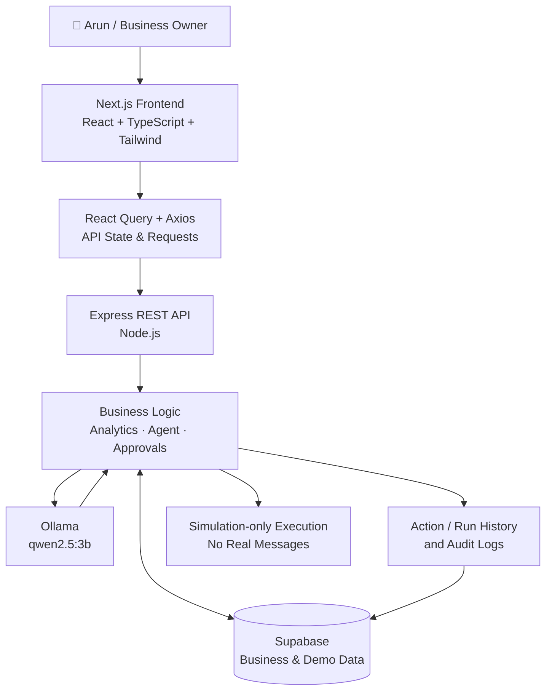
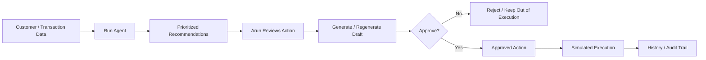

<div align="center">

# 🌱 GrowPilot AI

### Your AI-powered customer retention & business growth copilot

**Understand customers. Identify churn risk. Generate smart actions. Keep humans in control.**

[](https://nextjs.org/)
[](https://react.dev/)
[](https://www.typescriptlang.org/)
[](https://nodejs.org/)
[](https://supabase.com/)
[](https://ollama.com/)
[](#development-status)

**Full-stack AI application · Human-in-the-loop approvals · Demo-safe execution**

[Overview](#-overview) · [Features](#-features) · [Architecture](#-system-architecture) · [Getting Started](#-getting-started) · [Owner Journey](#-a-day-in-aruns-shoes) · [API](#-api-overview) · [Roadmap](#-development-status)

</div>

---

## ✨ Overview

Small businesses often have customer and transaction data but lack the time to turn it into timely, personalized follow-ups. **GrowPilot AI** is a full-stack customer-retention workspace that combines business analytics, customer monitoring, local AI-generated suggestions, and a human approval workflow.

The demo follows **Arun**, owner of **Arun Digital Services**, as he reviews customer activity and chooses which AI-recommended retention actions should proceed.

> **Important:** This is a development/demo project using sample business data. Message execution is **simulated**; the application does **not** send real WhatsApp, SMS, or email campaigns. AI recommendations are drafts that require human review.

### What makes it different?

| 🔍 Visibility | 🧠 Local AI | ✅ Human control | 📈 Measurement |
|---|---|---|---|
| See business and customer activity in one workspace | Generate suggested retention actions using Ollama | Review, edit/regenerate, approve, or reject actions | Explore transaction and service-fee trends |

## 🚀 Features

### 1. 📊 Dashboard — a business overview

A landing page for important metrics, recent activity, and an overview of the agent workflow. Designed to give Arun a quick starting point before drilling into customers or actions.

### 2. 👥 Customers — explore the customer base

- Browse customers in a responsive desktop table or mobile card view.
- Search, filter, sort, and paginate customers.
- Review customer activity to help identify potential follow-up opportunities.

### 3. 🤖 AI Agent — from signals to suggestions

- Run the retention agent for the demo business.
- Generate prioritized customer-retention action plans.
- Read the reasoning attached to suggested actions.
- Browse agent-run activity history.

**AI suggestions are not sent automatically.** They flow into a separate review process.

### 4. 🛡️ Approvals — human-in-the-loop execution

- Review pending AI-recommended actions.
- Generate or regenerate draft outreach messages.
- Approve or reject an action manually.
- View approved actions and simulate execution.
- Search/filter execution history.

This separation keeps **recommendation**, **authorization**, and **execution** as distinct steps.

### 5. 📈 Analytics — understand transaction performance

- Total customers and completed transactions.
- Service-fee revenue versus total transaction value.
- Monthly revenue chart and transaction trend chart.
- Transaction completion rate and monthly performance table.
- Responsive charts powered by real backend analytics responses.

**Metric clarity:** Service-fee revenue is *not* the same as the full transaction value. The latest month can be partial (month-to-date).

## 🧭 A day in Arun's shoes

Here is the practical demo journey for the business owner:

| Step | Where | What Arun does | What happens |
|:---:|---|---|---|
| 01 | **Dashboard** | Opens GrowPilot AI | Sees a high-level business snapshot and recent activity |
| 02 | **Customers** | Searches, filters, and reviews customers | Identifies which customers may need attention |
| 03 | **AI Agent** | Clicks **Run Agent** | Backend analyzes available business/customer information and prepares action suggestions |
| 04 | **AI Agent** | Reviews recommendations and reasoning | Understands the proposed retention action before acting |
| 05 | **Approvals** | Opens pending actions | Inspects what the AI is suggesting |
| 06 | **Approvals** | Generates or regenerates a draft message | Gets a proposed customer-facing message for review |
| 07 | **Approvals** | Approves or rejects each action | Records a deliberate human decision |
| 08 | **Approvals** | Simulates an approved action's execution | Records a demo execution event; **no real message is sent** |
| 09 | **Approvals** | Checks execution history | Reviews prior simulated workflow outcomes |
| 10 | **Analytics** | Examines revenue and monthly transaction trends | Understands historical business performance |

> **Example flow:** A customer appears inactive → the agent recommends a follow-up → Arun reads the reasoning → generates a draft → approves it → runs a simulation → reviews its record.

## 🏗️ System architecture



### How a request moves through the application

1. Arun clicks a control in the **Next.js** frontend.
2. A frontend hook calls the **Express REST API** via the API client.
3. The backend validates the request and runs the relevant service logic.
4. Services read/write demo business information in **Supabase**; agent functionality can call the local **Ollama** model.
5. The backend returns structured JSON.
6. **React Query** updates or refreshes frontend data; the UI shows the result and any errors.

### Why these technologies?

| Layer | Technology | Why it is used |
|---|---|---|
| Frontend framework | **Next.js 16 / React** | App Router, reusable components, modern client-side UI |
| UI language | **TypeScript** | Safer interfaces for API responses and component props |
| Styling | **Tailwind CSS v4** | Responsive layouts and consistent styling |
| Data fetching | **TanStack React Query** | Loading/error states, caching, and refetching |
| API client | **Axios** | Consistent frontend-to-backend HTTP requests |
| Visualization | **Recharts** | Revenue and transaction charts |
| Icons / feedback | **Lucide React / Sonner** | Recognizable icons and user notifications |
| Backend | **Node.js + Express** | REST routes, validation, and application workflows |
| Database | **Supabase** | Persistence for business, customer, transaction and workflow data |
| AI runtime | **Ollama** | Run an AI model locally during development |
| AI model | **qwen2.5:3b** | Produce AI-generated suggestions and draft content |

## 🗂️ Repository structure

```text
growpilot-ai/
├── frontend/                     # Next.js application
│   └── src/
│       ├── app/
│       │   └── (dashboard)/
│       │       ├── page.tsx       # Dashboard
│       │       ├── customers/     # Customer explorer
│       │       ├── agent/         # AI agent workspace
│       │       ├── approvals/     # Human review & execution
│       │       └── analytics/     # Business performance
│       ├── components/            # Shared UI and page components
│       ├── features/              # Feature-level APIs and hooks
│       └── lib/                   # API client and configuration
├── backend/
│   └── src/
│       ├── routes/                # REST endpoint definitions
│       ├── controllers/           # Request validation/handling
│       └── services/              # Business and AI workflows
├── .gitignore
└── README.md
```

*This tree highlights key areas rather than every file. The remaining sidebar destinations are listed in the roadmap below.*

## ⚙️ Getting started

### Prerequisites

- **Node.js** and **npm** compatible with the project's installed dependencies.
- A **Supabase** project with the required schema and demo data.
- **Ollama** installed and accessible locally.
- The **qwen2.5:3b** model downloaded.
- A local copy of this repository.

### 1. Clone the repository

```bash
git clone https://github.com/<YOUR_USERNAME>/<YOUR_REPOSITORY>.git
cd <YOUR_REPOSITORY>
```

Replace the placeholder with the repository URL once it is created.

### 2. Configure environment variables

Both applications may require local environment files. Create the files using **the variable names actually referenced by the project code** or maintained `.env.example` files:

```text
backend/.env
frontend/.env.local
```

Typically these include the backend port, Supabase connection credentials, the local Ollama endpoint, and the frontend's backend API URL. **Exact names are project-specific—check the source rather than copying guessed variable names.**

> 🔒 **Never commit `.env`, `.env.local`, tokens, passwords, or Supabase service-role credentials.** Keep secrets only in your local environment or a secure secrets manager.

### 3. Install dependencies

Open two terminals from the repository root:

**Terminal A — Backend**

```bash
cd backend
npm install
npm run dev
```

**Terminal B — Frontend**

```bash
cd frontend
npm install
npm run dev
```

> These commands assume both `package.json` files define a `dev` script. Confirm available commands with `npm run` inside each folder.

### 4. Set up local AI

```bash
ollama pull qwen2.5:3b
ollama serve
```

If Ollama is already running as a background service, starting it again may report that the address is in use; use the existing service instead.

### 5. Open the application

| Service | Default local URL |
|---|---|
| Frontend | `http://localhost:3000` |
| Backend | `http://localhost:5000` |
| Analytics API | `http://localhost:5000/api/analytics?businessId=<YOUR_BUSINESS_UUID>` |

Port settings may differ depending on local configuration. The seeded demo business used during development is **Arun Digital Services**.

### 6. Production build check

```bash
cd frontend
npm run build
```

## 🔌 API overview

The frontend communicates with the Express backend through JSON HTTP APIs.

| Method | Endpoint | Purpose |
|---|---|---|
| `GET` | `/api/analytics?businessId=...` | Business KPIs and monthly trends |
| `GET` | `/api/agent/history?businessId=...` | Paginated agent activity/audit history |
| `GET` | `/api/approvals/approved` | Retrieve approved actions |
| `GET` | `/api/approvals/history` | Retrieve execution history |
| `POST` | `/api/agent/insights` | Business insights generation endpoint; frontend page not yet implemented |

Other routes support customers, agent runs, approvals and simulated execution; **refer to `backend/src/routes/` for their exact methods, paths and request contracts**.

#### Example: analytics response shape

```json
{
  "success": true,
  "message": "Business analytics fetched successfully",
  "data": {
    "business": { "id": "<business-uuid>", "name": "Arun Digital Services", "owner_name": "Arun" },
    "summary": {
      "totalCustomers": 40,
      "totalTransactions": 200,
      "completedTransactions": 200,
      "totalRevenue": 4760,
      "totalTransactionValue": 190380,
      "customersWithCompletedTransactions": 40
    },
    "monthlyTrends": [
      {
        "month": "2026-10",
        "totalTransactions": 84,
        "completedTransactions": 84,
        "totalRevenue": 2412.68,
        "totalTransactionValue": 96499,
        "completionRate": 100
      }
    ],
    "generatedAt": "<ISO-8601-timestamp>"
  }
}
```

*Illustrative abbreviated response based on the development demo data; actual data changes with the database.*

## 🧠 The AI + approval workflow



The local model helps create suggested actions and message drafts. **The application is intentionally human-in-the-loop**: Arun reviews AI output, chooses the action, and only then can simulate an approved execution.

**AI safety / quality note:** Generated text may be inaccurate or inappropriate. Always inspect recommendations and message content before approval; a future production system would need consent checks, templates, delivery integrations, monitoring, and stricter safeguards.

## 🧪 Demo data and scope

This project's current seeded development dataset includes approximately:

| Demo entity | Count |
|---|---:|
| Customers | **40** |
| Transactions | **200** |
| Completed transactions | **200** |

The dataset illustrates features and should not be treated as a real production business performance report. Sample business metrics and AI output depend on the local database state.

## 🛠️ Development status

| Module | Status |
|---|---|
| Dashboard | ✅ Implemented |
| Customers | ✅ Implemented |
| AI Agent | ✅ Implemented |
| Approvals | ✅ Implemented |
| Analytics | ✅ Implemented |
| AI Insights page (`/insights`) | 🚧 Planned — backend endpoint exists |
| History page (`/history`) | 🚧 Planned — history exists within feature pages |
| Settings page (`/settings`) | 🚧 Planned |
| Final cross-browser / end-to-end QA | 🚧 Pending |
| Real outbound messaging | ⛔ Not implemented; simulation only |

> The sidebar already contains links to **Insights**, **History**, and **Settings**. These are planned destinations and may show 404 until their pages are created.

## 🗺️ Roadmap

- [ ] Build the dedicated **AI Insights** page.
- [ ] Build a unified **History** page for easy audit exploration.
- [ ] Build the **Settings** page for relevant business/app configuration.
- [ ] Complete end-to-end testing across desktop and mobile.
- [ ] Add automated tests and CI checks.
- [ ] Document database schema and environment setup using safe `.env.example` templates.
- [ ] Review security, permissions, and consent requirements before any production rollout.

## 🔐 Security and responsible use

- Environment secrets must never be committed to source control.
- This demo is **simulation-only**; no real outreach should be inferred from execution history.
- AI content is advisory and requires human review.
- Customer data, consent, and communication preferences would require proper access controls and governance for real-world use.
- Frontend code should never contain privileged Supabase credentials.

## ❓ Frequently asked questions

<details>
<summary><b>Does GrowPilot AI send actual customer messages?</b></summary>

No. Currently, execution is simulated so the team can demonstrate an approval and audit trail safely.

</details>

<details>
<summary><b>Is it using a hosted AI API?</b></summary>

The development setup uses **Ollama** with **qwen2.5:3b** locally. Backend services call the model as part of the AI workflow.

</details>

<details>
<summary><b>Does the AI approve actions automatically?</b></summary>

No. The owner reviews and explicitly approves or rejects proposed actions.

</details>

<details>
<summary><b>Why are service-fee revenue and transaction value different?</b></summary>

Service-fee revenue represents the business fee earned. Transaction value represents the larger total value of processed transactions. The analytics page shows these separately to avoid conflating them.

</details>

<details>
<summary><b>Can I deploy this directly to production?</b></summary>

Not yet. It is an actively developed demo that needs deployment configuration, authorization/consent controls, automated testing, operational monitoring, and a real messaging integration only when legally and operationally appropriate.

</details>

---

<div align="center">

### 🌱 Grow smarter. Retain better. Stay in control.

**GrowPilot AI** — built to make AI-assisted retention more understandable, reviewable, and actionable for small businesses.

<sub>Full-stack portfolio / development project · Active development</sub>

</div>
